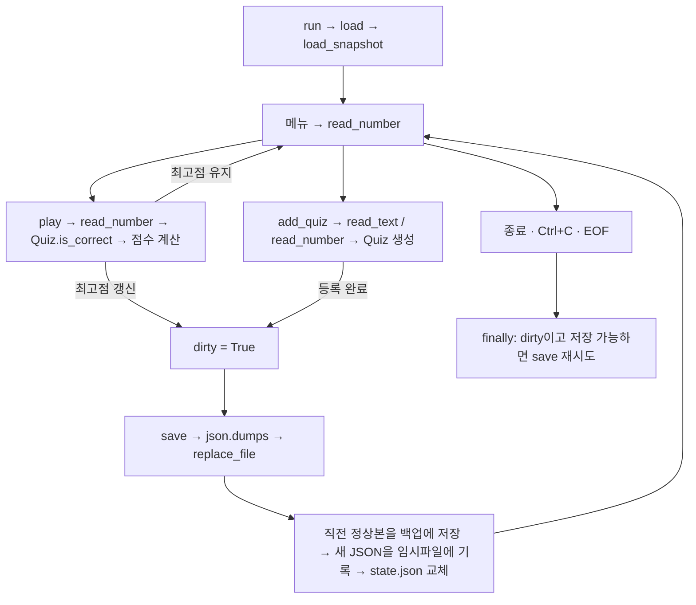

# 태양계 퀴즈

터미널에서 태양계 상식을 맞히는 4지선다 퀴즈입니다. 기본 문제는 태양계의 행성, 위성, 탐사선을 다룹니다. 친숙한 행성부터 실제 탐사 사례까지 한 판에서 함께 살펴볼 수 있어 이 주제를 골랐습니다.

## 실행

Python 3.10 이상이 필요합니다. 게임은 Python 표준 라이브러리만 사용합니다. 프로젝트 루트에서 실행하세요.

```bash
python main.py
```

Windows에서 Python 런처를 사용한다면 `py -3 main.py`로 실행할 수 있습니다.

## 메뉴

첫 실행 화면은 [menu.png](docs/screenshots/menu.png)에서 확인할 수 있습니다.

| 번호 | 기능 | 동작 | 콘솔 캡처 |
| --- | --- | --- | --- |
| 1 | 퀴즈 풀기 | 등록된 문제를 순서대로 풀고 문제별 정오답과 최종 점수를 확인합니다. | [play.png](docs/screenshots/play.png) |
| 2 | 퀴즈 추가 | 문제, 선택지 4개, 정답 번호를 입력하면 퀴즈를 저장합니다. | [add_quiz.png](docs/screenshots/add_quiz.png) |
| 3 | 퀴즈 목록 | 현재 등록된 문제를 확인합니다. | [list.png](docs/screenshots/list.png) |
| 4 | 점수 확인 | 완료한 게임의 최고 점수와 당시 정답 수를 확인합니다. | [score.png](docs/screenshots/score.png) |
| 5 | 종료 | 게임을 종료합니다. | [exit.png](docs/screenshots/exit.png) |

점수는 정답률을 100점 만점으로 환산해 소수점 아래를 버립니다. 동점이면 먼저 기록한 게임을 유지합니다. Ctrl+C 또는 입력 스트림 종료 시 완료된 변경의 저장을 시도하고 종료합니다.

## 파일 구조

| 파일 | 역할 |
| --- | --- |
| `main.py` | 게임 실행 진입점 |
| `game.py`, `quiz.py` | `QuizGame`은 메뉴, 입력 검증 호출, 게임 진행, JSON 저장과 복구를 맡습니다. `Quiz`는 문제 한 개의 데이터와 출력, 정답 확인을 맡습니다. |
| `questions.py` | 기본 태양계 문제 5개 |
| `state.json` | 플레이어가 추가한 퀴즈와 최고 점수 |
| `state.json.bak` | 직전 정상 저장본 한 개 |

기본 문제와 사용자가 등록한 문제는 같은 `Quiz` 검증과 채점 규칙을 공유합니다. 주제를 바꾸려면 `questions.py`에서 새로운 `Quiz`를 구성하면 됩니다. `QuizGame`에 별도의 `state_path`를 넘기면 테스트용 저장 파일로 같은 게임 흐름을 실행할 수 있습니다.

### 호출 흐름



파일이 없으면 기본값으로 메뉴를 엽니다. 파일이 손상되면 백업을 검사하고 복구를 시도한 뒤 메뉴를 엽니다. 목록 보기와 점수 확인은 메모리에 로드한 상태를 조회합니다. 저장이 성공하면 `dirty`를 해제합니다.

## 저장 데이터

프로젝트 루트의 `state.json`을 UTF-8 JSON으로 읽고 씁니다. JSON은 한글 문제, 선택지 배열, 점수 숫자, 미기록 상태인 `null`을 같은 파일에 읽기 쉬운 계층으로 담을 수 있습니다. CSV에 같은 구조를 담으려면 선택지 열이나 별도의 목록 인코딩 규칙을 정해야 합니다.

| 키 | 형식과 의미 |
| --- | --- |
| `quizzes` | 문제 목록. 각 원소는 `question`(문제), `choices`(문자열 4개), `answer`(정답 번호 1~4)를 갖습니다. |
| `best_score` | 최고 점수 (0~100) |
| `best_correct` | 최고 점수를 기록한 게임의 정답 수 |
| `best_total` | 최고 점수를 기록한 게임의 전체 문제 수 |

완료한 게임이 없는 경우 점수 관련 세 필드는 `null`입니다. 개인 플레이 파일인 `state.json`과 `state.json.bak`는 Git에서 제외합니다.

### 백업과 복구

1. 새로 저장할 때 직전 정상본이 있으면 `state.json.bak`로 보관합니다. 백업과 본 파일은 각각 같은 폴더의 임시파일에 완전히 쓴 뒤 `Path.replace()`로 교체합니다. 첫 저장은 본 파일을 생성합니다.
2. 실행 시 본 파일이 손상되면 백업의 UTF-8, JSON 구조, 퀴즈, 점수 필드를 검증합니다. 유효한 백업이 있으면 직전 정상 상태로 복구합니다. 사용 가능한 백업이 없으면 기본 문제 5개와 미기록 점수로 초기화합니다.
3. 본 파일이 삭제된 경우 기본 문제 5개로 시작합니다. 남아 있는 백업을 사용하려면 게임을 닫고 백업을 프로젝트 루트의 `state.json`으로 복사한 뒤 다시 실행하세요.

읽기 권한 오류가 나면 기본 문제로 시작하고 그 실행에서는 저장을 건너뜁니다. 프로젝트 폴더와 두 상태 파일의 읽기·쓰기 권한 및 파일 잠금 여부를 확인하세요. 권한을 고치기 어렵다면 프로젝트와 보존할 상태 파일을 쓰기 가능한 폴더로 복사해 그곳에서 실행할 수 있습니다.

쓰기 실패 시 변경사항은 메모리에 남고, 종료할 때 한 번 더 저장을 시도합니다. 재시도도 실패하면 기존 디스크 기록이 유지되며 메모리에만 남은 변경은 사라집니다. 종료 처리 대상은 정상 메뉴 종료, Ctrl+C, EOF이며, SIGTERM이나 강제 종료에는 별도 처리기가 없습니다.

### 기본 문제 수와 저장 검증

프로젝트 루트에서 다음 명령을 실행하면 임시 폴더의 초기 상태에서 문제 5개를 검증합니다.

```sh
python -c "from pathlib import Path; from tempfile import TemporaryDirectory; from game import QuizGame; tmp = TemporaryDirectory(); game = QuizGame(Path(tmp.name) / 'state.json'); game.load(); assert len(game.quizzes) == 5; print(len(game.quizzes)); tmp.cleanup()"
```

재실행 직전의 [state-before-restart.json](docs/evidence/state-before-restart.json)과 재실행 후의 [state-after-restart.json](docs/evidence/state-after-restart.json)은 검증용 게임에서 생성한 스냅샷입니다. 두 파일의 내용이 바이트 단위로 동일했고, 목록의 추가 문제와 최고 점수가 재실행 화면에 표시됐습니다. [입력 오류 및 재실행 증빙](docs/evidence/console.md)

### 문제 수가 늘어날 때

퀴즈 `n`개를 메모리의 리스트에 담으므로 메모리는 문제 데이터 크기에 비례합니다. 전체 목록과 제목 순차 검색은 최대 `n`개를 확인해야 하고, 로드와 저장은 전체 JSON을 읽거나 씁니다. 1,000개 이상을 운영할 때는 전체를 출력하는 목록에 페이지를 추가하고, 특정 ID 검색이 필요하다면 사전 인덱스나 SQLite 인덱스를 고려할 수 있습니다. 페이지는 출력량을 줄이며, 사전 인덱스는 조회 속도와 추가 메모리를 맞바꿉니다.

## 변경 시 확인할 코드

| 변경 요구 | 수정 위치 | 함께 확인할 항목 |
| --- | --- | --- |
| 점수 계산, 동점 기준, 표시 형식 | `game.py`의 `QuizGame.play()`, `show_score()` | `load_snapshot()`의 점수 검증식, `best_score`, `best_correct`, `best_total`의 기존 저장값 호환 |
| 퀴즈 필드, 선택지 수 또는 정답 규칙 | `quiz.py`의 `Quiz.__init__()`, `display()`, `is_correct()` | `questions.py` 기본 데이터, `add_quiz()`와 `play()`의 입력 범위, `save()`와 `load_snapshot()`의 `quizzes` 스키마 |
| 저장 경로, JSON 구조 또는 백업 정책 | `QuizGame.__init__()`, `save()`, `load()`, `load_snapshot()`, `replace_file()` | 기존 `state.json`과 `state.json.bak` 호환 또는 마이그레이션, 권한 오류 및 손상 복구 테스트 |
| 메뉴 추가 또는 번호 변경 | `QuizGame.show_menu()`, `run()` | 메뉴 입력 범위와 분기, README 메뉴 표 |

## Git 작업 규칙

하나의 커밋에는 독립적으로 설명하고 검증할 수 있는 변경 한 가지를 넣습니다. 예를 들어 백업 동작과 그 회귀 테스트는 한 변경으로 묶고, 사용 안내와 제출 증빙은 문서 커밋으로 나눕니다.

메시지 템플릿은 `<유형>: <무엇을 바꿨는지 한 줄 요약>`입니다. 유형은 기능 `Feat`, 수정 `Fix`, 문서 `Docs`, 구조 정리 `Refactor`, 테스트 `Test`를 사용합니다. 예시는 `Feat: 퀴즈 출제와 풀이 결과 표시`, `Fix: 손상된 상태를 직전 정상본에서 복구`, `Docs: 재실행 증빙과 메뉴 캡처 연결`입니다.

## 제출 자료

- 공개 원격 저장소 [jung78HN/el-2](https://github.com/jung78HN/el-2)
- [개발 환경](docs/screenshots/environment.png)과 [Git 커밋 그래프](docs/screenshots/git-log.png). 그래프의 `9698d62`는 퀴즈 풀이 브랜치 `codex/quiz-play`를 `main`에 병합한 커밋입니다.
- Git 작업 콘솔 [git-clone.png](docs/screenshots/git-clone.png)와 [git-pull.png](docs/screenshots/git-pull.png)
- [테스트 케이스와 실행 결과](docs/test-cases.md)

실행 화면은 실제 콘솔 출력과 입력을 기록한 뒤 읽기 쉬운 크기로 캡처했습니다.
